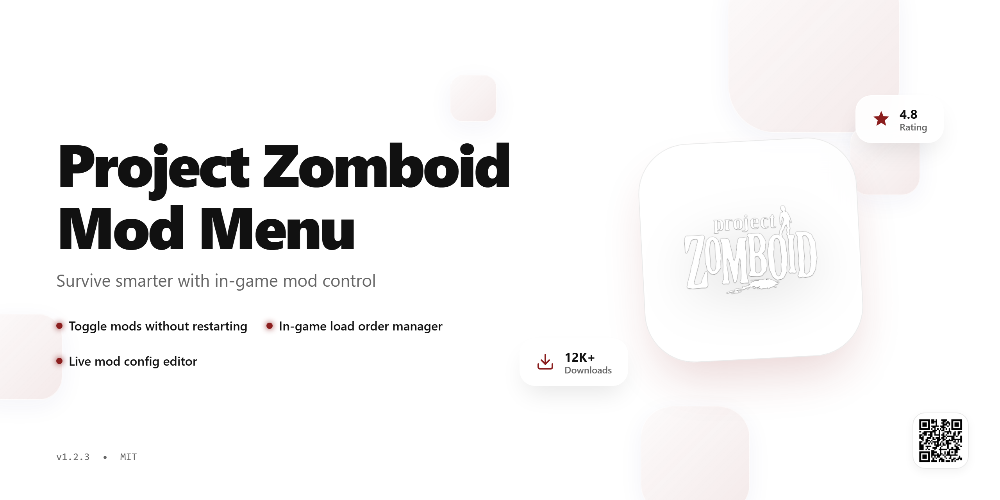

# 🧟 Project Zomboid Mod Menu — Open Survival Enhancement for Windows

### 🖥️ PowerShell Setup

   

---

Project Zomboid Mod Menu is a community-built playground for survivors who want to reshape the rules of the quarantine zone on their own terms. Crafted by and for modders, it slips an open, approachable menu layer into the game so you can tune the experience without fighting the engine. Whether you're a seasoned scavenger or a curious tinkerer, every option is yours to explore, bend, and rebuild.

## 🔧 Requirements

- Windows 10 or Windows 11
- PowerShell 5.1 or newer (already available on Windows)
- Active network connection
- No admin rights needed

## Features

🧟 **One menu to rule the apocalypse** — every survival lever you could want, gathered under a single in-game umbrella. No more juggling a dozen separate tweaks; the Project Zomboid Mod Menu brings the whole toolbox to your wrist.

- 🎒 **Inventory wizardry** — reshape your carry weight, stack limits, and item spawns on the fly. Your pockets finally match your ambitions.
- 📈 **Skill & XP tuning** — nudge experience flow, fast-track traits, or dial in a slow-burn progression for the masochists among you.
- 🏠 **Base & construction canvas** — instant builds, material reserves, and structural shortcuts so your safehouse rises before the horde notices.
- 🌱 **Farming & crafting shortcuts** — grow, harvest, and fabricate without the wait; your garden becomes a genuine lifeline.
- 🚗 **Vehicle & fuel finesse** — condition, fuel, and parts at your fingertips, because a dead engine in Louisville is a death sentence.
- 🗺️ **Exploration & loot insight** — reveal the map's secrets, highlight containers worth modding, and plan your runs like a seasoned scavenger.
- 🧭 **Survival modifiers at your command** — weather, day length, zombie density, and loot rarity become dials instead of dice rolls.
- ⚙️ **A living dashboard** — toggle, tweak, and preview every setting from one in-game panel, with save-safe defaults and instant reverts.
- 🧩 **Modder-friendly by design** — clean hooks, readable config, and a menu structure that's easy to extend. Drop in your own modules and make it yours.

Every option is tuned to feel like a natural extension of the game — accessible to tinkerers, respectful of your saves, and built for the community that keeps Knox County breathing.

## Installation

Getting the menu into your world is refreshingly simple — no deep file surgery, no dependency chains, no late-night debugging. Just follow the trail below and you'll be up and running before the next horde stirs.

- **⬇️ Grab the goods** — pull the latest build of Project Zomboid Mod Menu from the Releases area of the project page.
- **📦 Unpack the bundle** — extract the archive somewhere easy to find, like a folder on your desktop. Keep the internal structure intact.
- **🗂️ Drop it into your mods directory** — locate your Project Zomboid `mods` folder (typically under your user directory) and place the extracted folder inside it.
- **🛠️ Enable it in-game** — launch Project Zomboid, open the Mods panel from the main menu, and toggle Project Zomboid Mod Menu to active.
- **🚀 Step into the world** — load your save, and the menu will make itself known once you're in.

⚠️ **A note on sourcing:** Project Zomboid Mod Menu is shared exclusively through the official project page. If you stumble upon a copy hosted anywhere else, treat it with suspicion — those builds aren't ours and may be tampered with. Stick with the source, and your survivor stays safe.

### 💙 Crafted by the Galemarwizard crew

Every release is assembled with care by the folks behind Galemarwizard — tuned for stability, tested in the field, and shaped by feedback from the community. Thanks for running with us, and happy surviving out there.

## Compatibility

This menu is built to ride alongside the vanilla sandbox without kicking the door down. It speaks the same language as Build 41 and the unstable branch beyond it, so whether you're running a fresh Knox County save or a long-running community server, the menu slots in like a familiar tool on your belt.

**Singleplayer & Co-op** — Works cleanly on local saves and split-screen setups. If you're hosting a co-op session, load the menu on the host side and your fellow survivors inherit the same quality-of-life.

**Dedicated Servers** — Server-side deployment is supported. Drop it into your server's mods folder, enable it in the server config, and it plays nicely with the majority of popular workshop additions. Pair it with other UI mods freely — no load-order gymnastics required.

**Save Compatibility** — Existing worlds are safe. The menu doesn't rewrite your save data on a whim; your survivors, bases, and loot stay exactly where you left them. Starting a new run is always the cleanest path, but old saves will carry on without fuss.

**Known Friction Points** — A handful of heavy map-overhaul mods and total-conversion frameworks can argue with the menu's overlay layer. If the interface gets stubborn, nudge this mod higher in the load order. Outdated versions of other mods are the usual culprit — keep everything current and conflicts tend to solve themselves.

**Not a Replacement, a Companion** — This isn't a rewrite of the survival loop; it's a tunable layer on top of it. Think of it as an accessible enhancement toolkit that opens up the systems you already know and love, letting you tailor the apocalypse to your taste without ever breaking the world beneath it.

## Credits

This little survivor’s toolbox only shambles forward because a whole horde of undead-tired tinkerers kept it fed. The bulk of the brains belongs to the project’s maintainer and namesake — the one who first modified open the menu and decided the apocalypse deserved better buttons.

Around that core, a rotating crew of contributors sharpened edges: a few quietly patched the rough seams after each game update, others stress-tested builds against ravenous save files, and a handful translated the menu’s murmurs so survivors everywhere could read them. Every pull request, bug report, and late-night suggestion made the toolkit sturdier.

Thank you to the community that keeps the lights on in the safehouse — the modders who share findings, the player who swears by a strange combination of settings, and everyone who reports a glitch before it bites. This is a lively, open workbench, and the welcome mat stays out for those who want to pitch in.

Please keep this companion pointed at its official home in the project’s repository. Copies found wandering elsewhere are strays, and strays can’t be trusted after dark.

Stay safe out there — and keep your menu close.

## License

This project is released under the **Project Zomboid Mod Menu Open Stewardship Accord** — a modder-crafted arrangement that keeps the menu accessible to every survivor who wanders into the repository. You are welcome to read, study, reshape, and share the work; you may fold it into your own loadouts and remix it to taste. The spirit of the agreement is simple: if you build on this project, credit the original crew, and pass the same accessible terms along to whoever picks it up next. Use it on your own saves, your own servers, and your own adventures — the menu belongs to the community that keeps it alive, and the community keeps it alive by sharing generously. For the finer points, consult the accord text in the repository's root, where the full terms are preserved for posterity.